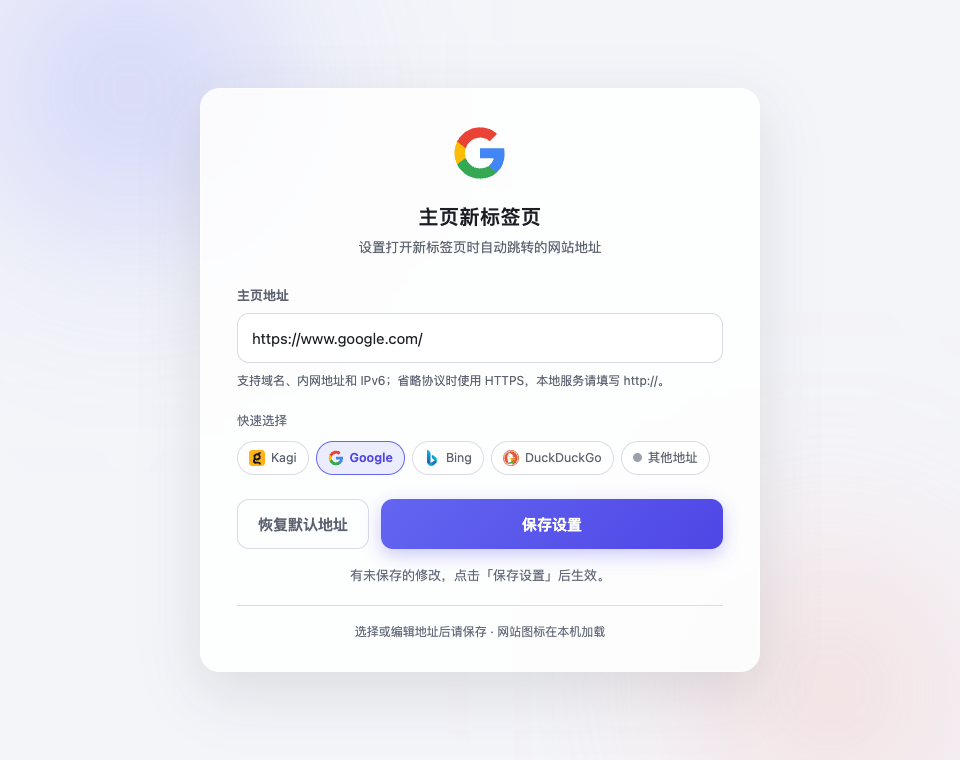

<a href="https://opc.fish"><picture><source media="(prefers-color-scheme: dark)" srcset="https://raw.githubusercontent.com/YE4IM/readme/main/project%20readme/assets/opc-fish-project-signature-web-dark.svg"></picture></a>

# Homepage New Tab

[English](./README.md) | [**中文**](./README-zh-CN.md)

这款 Chrome 扩展让每个新标签页自动打开你选定的网站。

[查看安装步骤](#安装)



## 目录

[概述](#概述) · [环境要求](#环境要求) · [安装](#安装) · [快速开始](#快速开始) · [功能](#功能) · [用法](#用法) · [故障排除](#故障排除) · [测试](#测试) · [变更日志](#变更日志) · [许可证](#许可证)

## 概述

你可以把常用的搜索引擎、工作仪表板或本地服务设成新标签页的起点。默认地址是 `https://kagi.com/`。

## 环境要求

- 支持 Manifest V3 和加载已解压扩展程序的 Google Chrome。
- 用于克隆仓库的 Git。

## 安装

1. 克隆仓库。

   ```bash
   git clone https://github.com/YE4IM/chrome-new-tab-page.git
   ```

2. 打开 `chrome://extensions`，开启**开发者模式**。
3. 点击**加载已解压的扩展程序**，选择包含 `manifest.json` 的 `chrome-new-tab-page` 目录。

## 快速开始

安装后打开一个新标签页。使用默认设置时，浏览器会打开 `https://kagi.com/`。

## 功能

- 新标签页开始加载时即可读取本地缓存的主页地址并发起跳转。
- 主页设置仅保存在当前设备。
- 仅申请 `storage` 权限。扩展从本地加载图标，通过浏览器正常导航访问目标网站。
- 设置页和恢复页跟随浏览器语言显示英文或简体中文，其他语言使用英文。

## 用法

1. 从工具栏的扩展菜单打开**选项**。
2. 选择 Kagi、Google、Bing 或 DuckDuckGo，也可以输入自定义的 HTTP 或 HTTPS 地址。省略协议时会使用 HTTPS。访问本地 HTTP 服务时，请填写完整地址，例如 `http://localhost:3000/`。
3. 点击**保存设置**，再打开一个新标签页确认跳转地址。

要恢复 Kagi，请点击**恢复默认地址**并保存。

更新时，在原目录替换文件，然后在 `chrome://extensions` 中点击该扩展的**重新加载**。升级到 2.2.2 时，如果旧版启用了主页同步，扩展会把 Chrome 能读取的最后一次同步地址迁入本机。如果暂时无法读取同步地址，扩展会打开本机主页，并在下次读取设置时重试迁移。在选项页手动保存的地址会立即生效。

## 故障排除

- 如果新标签页停在恢复页，可以点击主页链接、打开设置或重试跳转。

## 测试

在仓库根目录用 Node.js 运行单元测试，覆盖地址校验、设置迁移与读写、跳转缓存和恢复页链接。

```bash
node --test
```

既有手动验证步骤和截图见[实机测试报告](./docs/实机测试报告.md)。

## 变更日志

版本历史见[双语变更日志](./CHANGELOG.md)。

## 许可证

[MIT](./LICENSE)
