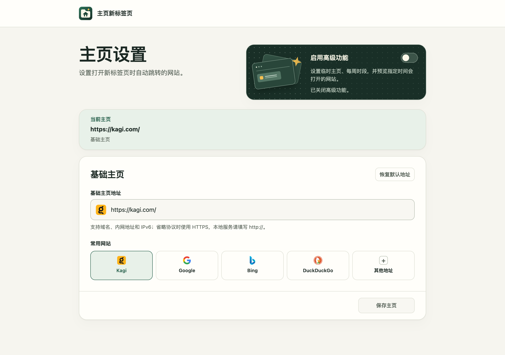
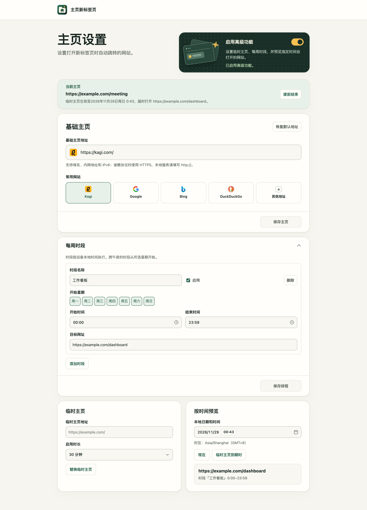

<p align="center">
<a href="https://opc.fish" title="OPC.FISH Project."><picture><source media="(prefers-color-scheme: dark)" srcset="https://raw.githubusercontent.com/YE4IM/readme/main/project/assets/opc-fish-project-signature-dark.svg"></picture></a>
</p>

# Homepage New Tab

[English](./README.md) | [**中文**](./README-zh-CN.md)

一款 Chrome 扩展，让每个新标签页自动打开你选定的网站。

[](./LICENSE) [](./manifest.json) [](./src) [](./manifest.json)

[查看安装步骤](#安装)



## 目录

[概述](#概述) · [环境要求](#环境要求) · [安装](#安装) · [快速开始](#快速开始) · [用法](#用法) · [故障排除](#故障排除) · [测试](#测试) · [变更日志](#变更日志) · [许可证](#许可证)

## 概述

新标签页可以打开常用搜索引擎、工作看板或本地服务。你可以设置每周时段，也可以在开会时临时切换到会议页面。

## 环境要求

- 支持 Manifest V3 和加载已解压扩展程序的 Google Chrome。
- 运行测试需要 Node.js。

## 安装

1. 打开 [GitHub 最新发布页](https://github.com/YE4IM/chrome-new-tab-page/releases/latest)，从 **Assets** 下载 **Source code (zip)** 并解压。
2. 打开 `chrome://extensions`，开启**开发者模式**。
3. 点击**加载已解压的扩展程序**，选择包含 `manifest.json` 的解压目录。

要更新已解压安装的扩展，将解压后的扩展文件复制到原扩展目录，再到 `chrome://extensions` 点击该扩展的**重新加载**。原先保存的主页会成为基础主页。

## 快速开始

打开一个新标签页。默认情况下，Chrome 会打开 `https://kagi.com/`。如需更换，打开扩展的**选项**，在**基础主页地址**中填入网址，再点击**保存主页**。高级功能关闭时，每个新标签页都会打开基础主页。

## 用法

打开**启用高级功能**开关后，即可使用临时主页、每周时段和按时间预览。全新安装默认关闭。从 2.3.0 升级时，如果有已保存的每周规则或仍有效的临时主页，开关会自动打开。

| 目标 | 选项中的操作 |
| --- | --- |
| 设置基础主页 | 选择 Kagi、Google、Bing 或 DuckDuckGo，也可输入 HTTP 或 HTTPS 网址。省略协议时使用 HTTPS。访问本地 HTTP 服务时填写完整地址，例如 `http://localhost:3000/`。 |
| 按每周时段切换 | 在**每周时段**中填写名称、开始星期、起止时间和目标网址。规则在开始时刻生效，在结束时刻失效。周五 22:00 至 02:00 会持续到周六凌晨。启用的时段若有重叠，需先调整再保存。每周时段与基础主页分开保存。 |
| 临时切换主页 | 在**临时主页**中输入网址，选择启用 30 分钟、1 小时或持续至指定时间。点击**提前结束**后，下一个新标签页按当前排程跳转。 |
| 查看跳转目标 | **当前主页**始终显示现在会打开的地址。启用高级功能后，可在**按时间预览**中指定本地日期和时间，或查看临时主页到期时的结果。预览包含草稿，新标签页使用已保存的排程。 |

启用高级功能后，新标签页依次检查临时主页、每周时段和基础主页。每周时段跟随设备当地时间。关闭开关后，下一个新标签页会打开基础主页，已保存的规则和临时主页的原到期时间都会保留。重新开启时，已到期的临时主页会被跳过。



主页设置仅保存在当前设备。扩展仅申请 `storage` 权限。选项页和恢复页支持英文与简体中文，其他语言使用英文。

## 故障排除

如果自动跳转迟迟未完成，可以在恢复页手动打开主页、进入选项页或重试。

## 测试

在仓库根目录运行测试。

```bash
node --test
```

Chrome 升级与重启验证见[实机测试报告](./docs/实机测试报告.md)。

## 变更日志

版本历史见[变更日志](./CHANGELOG-zh-CN.md)。

## 许可证

[MIT](./LICENSE)
