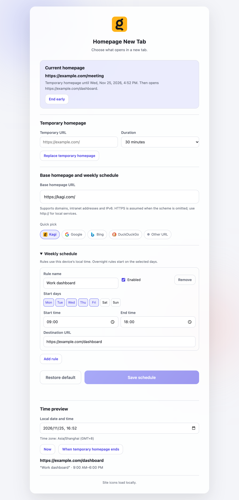

<a href="https://opc.fish" title="OPC.FISH Project."><picture><source media="(prefers-color-scheme: dark)" srcset="https://raw.githubusercontent.com/YE4IM/readme/main/project%20readme/assets/opc-fish-project-signature-web-dark.svg"></picture></a>

# Homepage New Tab

[**English**](./README.md) | [中文](./README-zh-CN.md)

A Chrome extension that opens a website of your choice whenever you open a new tab.

[Go to installation](#installation)



## Contents

[Overview](#overview) · [Requirements](#requirements) · [Installation](#installation) · [Quick Start](#quick-start) · [Usage](#usage) · [Troubleshooting](#troubleshooting) · [Testing](#testing) · [Changelog](#changelog) · [License](#license)

## Overview

Start new tabs at your search engine, work dashboard, or local service. Set weekly hours for a different destination or switch to a meeting page temporarily.

## Requirements

- Google Chrome with support for Manifest V3 and loading unpacked extensions.
- Node.js to run the tests.

## Installation

1. Open the [latest GitHub Release](https://github.com/YE4IM/chrome-new-tab-page/releases/latest), download **Source code (zip)** from **Assets**, and extract it.
2. Open `chrome://extensions` and enable **Developer mode**.
3. Select **Load unpacked** and choose the extracted folder containing `manifest.json`.

To update an existing unpacked installation, copy the extracted extension files into the existing extension directory. Then open `chrome://extensions` and click **Reload** on the extension. Your saved homepage becomes the base homepage.

## Quick Start

Open a new tab. With the default settings, Chrome opens `https://kagi.com/`. To use another site, open the extension’s **Options**, enter its address under **Base homepage URL**, and click **Save schedule**. The next new tab opens that address.

## Usage

| To | In Options |
| --- | --- |
| Set a base homepage | Choose Kagi, Google, Bing, or DuckDuckGo, or enter an HTTP or HTTPS address. The extension assumes HTTPS if you omit the scheme. Enter the full address for a local HTTP service, such as `http://localhost:3000/`. |
| Schedule a different homepage | Under **Weekly schedule**, add a name, starting days, hours, and a destination. The start is inclusive and the end is exclusive. A Friday rule from 22:00 to 02:00 runs into Saturday. Adjust overlapping enabled rules before saving. |
| Switch temporarily | Enter a destination under **Temporary homepage** and enable it for 30 minutes, one hour, or until a date and time you choose. Select **End early** to apply the current schedule to the next new tab. |
| Check a destination | **Current homepage** shows what opens now. **Time preview** lets you check a local date and time or jump to the temporary homepage’s expiry. The preview includes your draft. New tabs use the saved schedule. |

A new tab checks the temporary homepage first, then the weekly schedule, then the base homepage. Weekly rules follow the device’s local time. A temporary homepage keeps the expiry set when you enabled it.

Homepage settings are stored on this device. The extension requests only the `storage` permission. Options and recovery are available in English and Simplified Chinese, with English as the fallback.

## Troubleshooting

If an automatic redirect stalls, use the recovery page to open the homepage manually, open Options, or retry.

## Testing

Run the tests from the repository root.

```bash
node --test
```

See the [browser test report](./docs/实机测试报告.md) for the Chrome upgrade and restart checks.

## Changelog

See the [bilingual changelog](./CHANGELOG.md) for version history.

## License

[MIT](./LICENSE)
